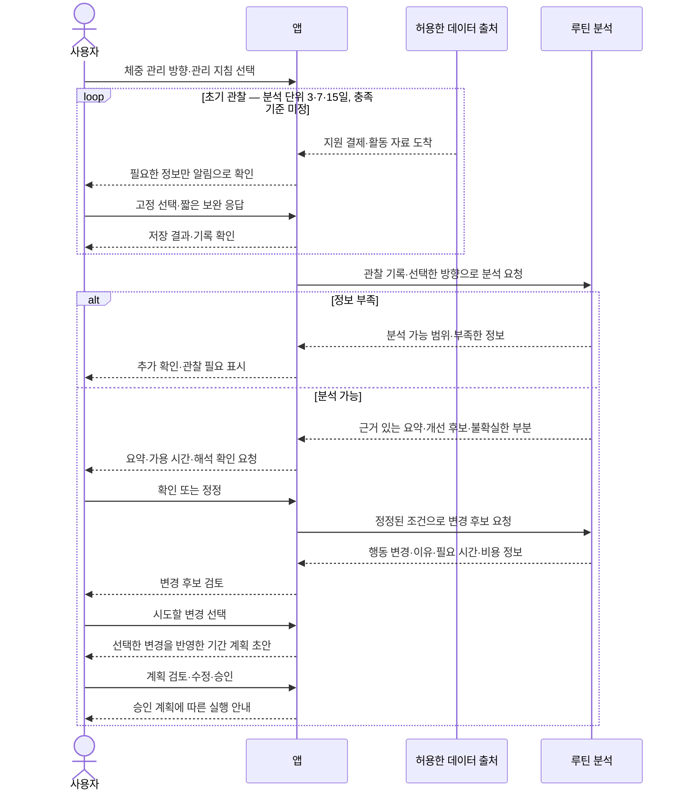
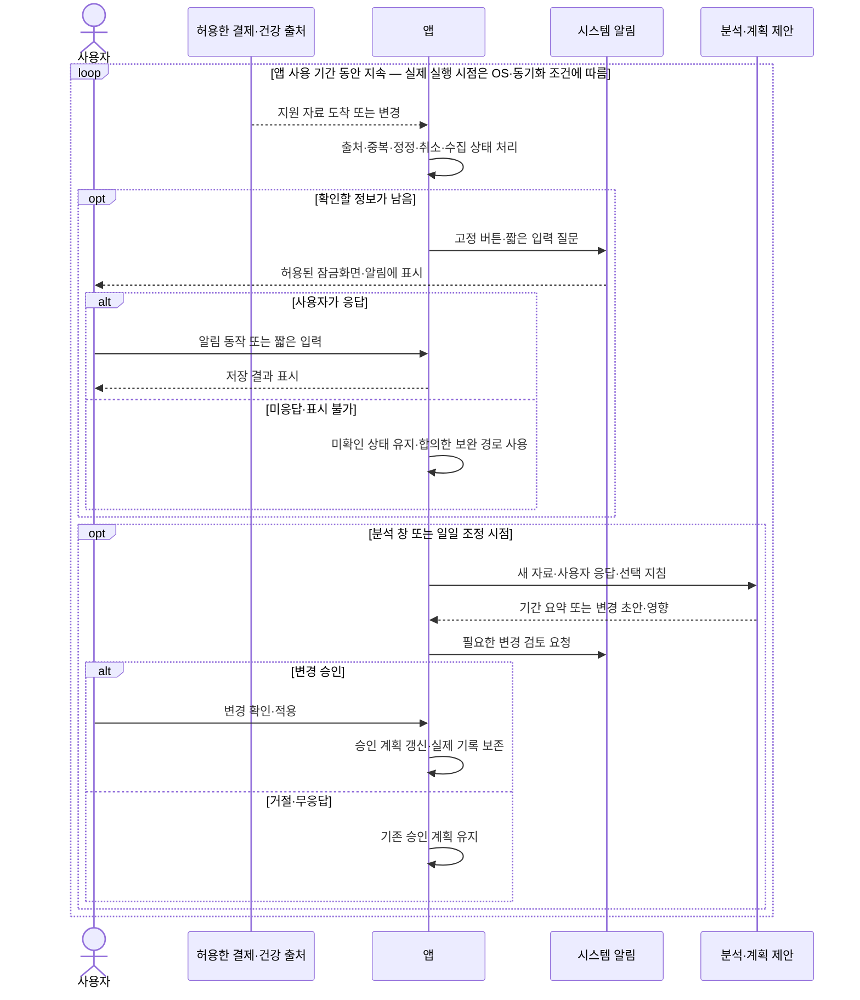
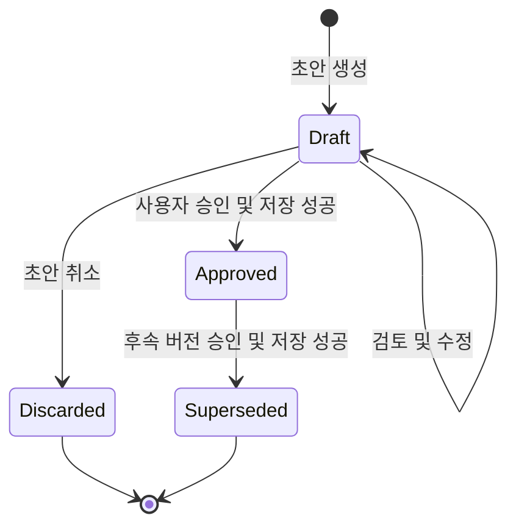
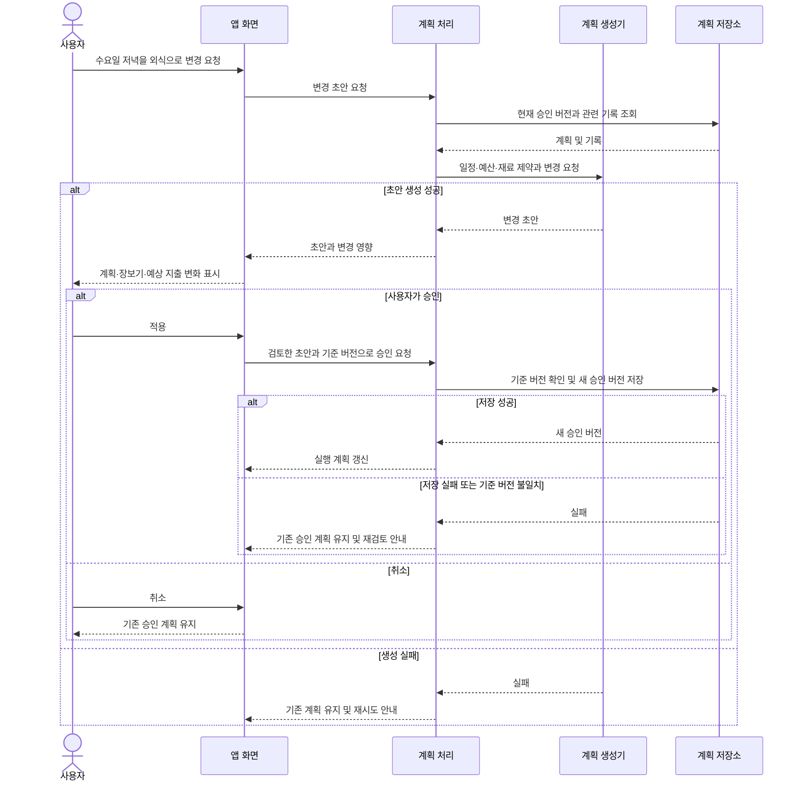
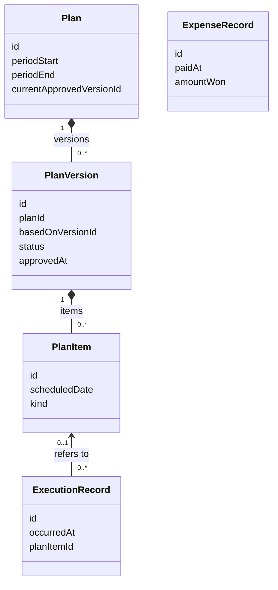
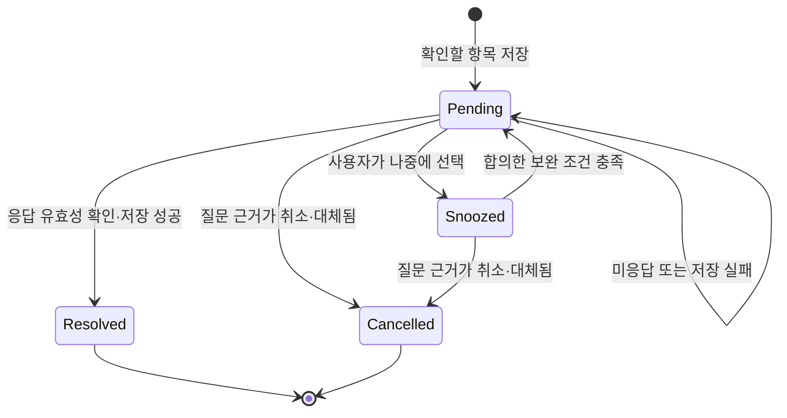

# 초기 UML 모델

상태: 논의를 위한 초안. 요구분석에 따라 갱신 중이며 구현 명세가 아니다.
기준일: 2026-10-18 (Asia/Seoul)

최신 요구는 [요구분석명세서 v0.3/R1](REQUIREMENTS_SPECIFICATION.md) 작성 완료·검토본을 따른다. 초기 루틴 관찰·분석이 먼저이며 사용 전 기간의 자동 수집·알림 응답·기간 분석·매일 조정으로 이어진다. 기존 승인 상태도·클래스는 계획 관리의 하위 모델이다.
기능·상호작용의 구체화는 [설계 D0.1](design/DESIGN.md)에 기록한다. 상세 아키텍처·클래스는 아직 확정하지 않았다.

## 1. 시스템 경계와 유스케이스 목록

주 액터는 사용자 본인이다. 결제·건강 자료 제공 시스템과 Android 권한·알림 시스템은 외부 액터로 모델링한다. 실제 공급 경로, AI 제공자와 향후 동기화 서버는 검증·선택 전이다. 앱 내부의 저장소·분석 모듈은 액터로 두지 않는다.

목록과 상세화 기준은 [유스케이스 목록 UC0.1](USE_CASES.md)에서 관리한다. 사용자 목적 중심 18개와 외부 연동 2개를 식별했으며 각 사례에 시작 계기·결과·요구 ID·상태를 연결했다.
각 사례와 전체 여정의 일곱 항목 상세 초안은 [유스케이스 명세서 UCS0.1](USE_CASE_SPECIFICATION.md)을 따른다. 기본·예외 이벤트 흐름과 성공·중단 후행 조건을 후속 UML·화면 검토의 입력으로 사용하며, 우선순위·미정 정책을 확정된 것으로 해석하지 않는다.

- UC-ROUTINE-001은 초기 관찰에서 첫 변경 선택까지의 전체 여정이다.
- UC-CAPTURE-001은 자동 수집에서 필요한 빠른 확인까지의 전체 여정이다.
- UC-PLAN-001은 기존의 기간별 계획 검토·승인 사례로 유지한다.
- 전체 여정과 개별 목적을 중복 합산하지 않는다. 자료 도착·시각 도래로 시작하는 흐름도 포함하며, 모든 사례가 사용자의 앱 실행으로 시작하지는 않는다.

현재 목록은 정식 UML 유스케이스 다이어그램이 아니다. 상세 흐름을 검토한 뒤 시스템 경계·액터와 필요한 `include`·`extend` 관계를 도식화한다. 목록의 새 ID는 새 기능의 도입을 뜻하지 않는다.

### 1.1 기존 루틴에서 첫 변경 계획까지 — 시퀀스 초안

관리 방향 선택 시점과 확인 단계는 개발 제안이다. 분석의 누적·이동 창, 정보 충족·부족 처리·변경 수는 아직 합의하지 않았다.
루틴 분석은 생활 기록에서 패턴을 정리하는 기능이며 기록만으로 체중·근육량 변화나 의학적 원인을 판정하지 않는다.
참여자는 책임을 표현하며 별도 서버·클래스 구성을 확정한 것은 아니다.

### 1.2 사용 기간 내내 자동 수집·알림 확인·계획 조정

3·7·15일은 수집을 멈추는 시점이 아니다. 이 시퀀스는 일정 수준의 데이터 도착·수집이 가능한 환경을 전제로 한 개념 흐름이며 즉시·완전 수집을 보장하지 않는다.
알림 표시·동작의 실기 제약은 [연동 검토](INTEGRATION_OPTIONS.md)를 따른다. 모든 사건에 확인을 강제하지 않으며 자동 적용 가능한 작은 변경의 위임 범위는 아직 미정이다.

## 2. 계획 버전의 상태도

- Approved는 사용자가 승인한 계획 버전이다. 여러 주의 승인 계획은 함께 존재할 수 있다.
- Approved를 수정할 때는 새로운 Draft를 만들고 기존 버전은 유지한다.
- 후속 버전의 승인·저장이 성공할 때 같은 계획의 기존 버전을 Superseded로 바꾼다. 전환은 일관되게 저장되어야 한다.
- 실제 식사·운동·결제 기록은 별도 데이터다. 계획 버전의 전환으로 삭제하거나 재작성하지 않는다.
- 월간·주간 계획 사이의 승인 관계, 만료·완료 상태 필요 여부는 미정이다.

## 3. 승인된 계획을 수정하는 시퀀스

계획 생성기는 처음에 예시 데이터를 반환하고 이후 AI 연동으로 바꿀 수 있다. 참여자는 책임을 표현하며 모두 별도 클래스나 서버로 만든다는 뜻은 아니다.

## 4. 개념 클래스 관계

아래는 기존 계획·기록 관리 부분의 개념 모델이다. 관찰 기록·관리 지침·분석 근거·변경 후보의 상세 관계는 요구 합의 후 보완한다.

- 초안 단계의 계획도 다루므로 승인 버전은 초기에는 없을 수 있다.
- 식사·운동 항목의 세부 속성과 월간·주간 계획의 구조는 요구분석 이후 정한다.
- ExecutionRecord는 계획 밖의 식사나 운동도 기록할 수 있도록 연결을 선택 사항으로 둔 개념이다.
- ExpenseRecord는 실제 결제를 나타낸다. 식재료를 여러 끼에 나누어 써도 결제액을 매번 더하지 않는다.
- 금액 집계와 재료·장보기 목록 사이의 상세 관계는 아직 설계하지 않았다.
- 이 모델은 DB 스키마 또는 Dart 클래스의 최종 형태가 아니다.

## 5. 확인 항목 상태 — D0.1 설계 초안

관련 요구: REQ-INTERACT-001/002, REQ-INGEST-004, NFR-DATA-001.

알림이 화면에서 지워진 것과 확인 항목의 완료·취소는 별개다. 종결 상태는 처리 결과이며 실제 기록이나 응답을 삭제한다는 뜻이 아니다.
오래된 알림 동작은 현재 대상·상태를 확인한 뒤 처리하고, 응답 재전달·재시도로 기록을 중복 생성하지 않는다.
계획 변경 검토의 거절·승인은 계획 규칙을 따른다. 이 상태도는 업무 규칙의 상세 구현이나 자동 위임 권한을 확정하지 않는다.
