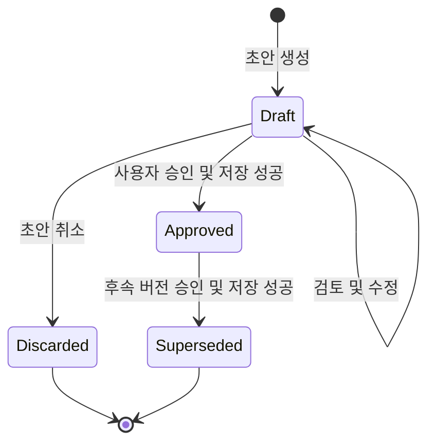
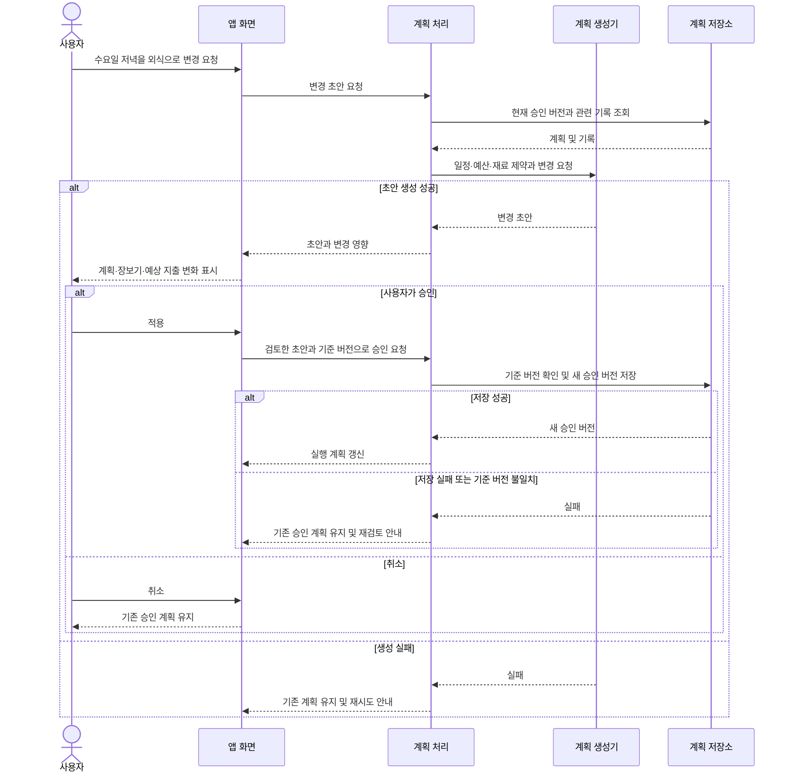
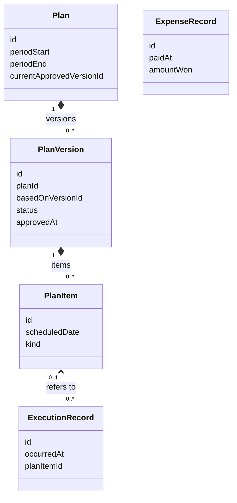

# 초기 UML 모델

상태: 논의를 위한 초안. 요구분석 전의 개념 모델이며 구현 명세가 아니다.
기준일: 2026-10-15 (Asia/Seoul)

## 1. 시스템 경계와 유스케이스 목록

주 액터는 사용자 본인이다. AI 제공자와 향후 동기화 서버는 외부 시스템 후보이며 아직 정하지 않았다.

| 사용자 목적 | 시스템의 역할 |
|---|---|
| 월간 방향 설정 | 식비와 건강·운동 방향을 저장 |
| 기간별 계획 검토 | 계획 초안, 장보기 목록, 예상 지출 표시 |
| 계획 수정 및 승인 | 요청 반영, 변경 영향 표시, 승인 버전 보존 |
| 계획 실행 | 오늘 할 일과 조리 안내 표시 |
| 실제 결과 기록 | 식사·운동·실제 지출 보관 |
| 다음 계획 개선 | 기록을 바탕으로 다음 기간의 제안 조정 |

위 표는 유스케이스 목록이다. 정식 UML 유스케이스 다이어그램은 요구분석 시 필요하면 추가한다.

## 2. 계획 버전의 상태도

- Approved는 사용자가 승인한 계획 버전이다. 여러 주의 승인 계획은 함께 존재할 수 있다.
- Approved를 수정할 때는 새로운 Draft를 만들고 기존 버전은 유지한다.
- 후속 버전의 승인·저장이 성공할 때 같은 계획의 기존 버전을 Superseded로 바꾼다. 전환은 일관되게 저장되어야 한다.
- 실제 식사·운동·결제 기록은 별도 데이터다. 계획 버전의 전환으로 삭제하거나 재작성하지 않는다.
- 월간·주간 계획 사이의 승인 관계, 만료·완료 상태 필요 여부는 미정이다.

## 3. 승인된 계획을 수정하는 시퀀스

계획 생성기는 처음에 예시 데이터를 반환하고 이후 AI 연동으로 바꿀 수 있다. 참여자는 책임을 표현하며 모두 별도 클래스나 서버로 만든다는 뜻은 아니다.

## 4. 개념 클래스 관계

- 초안 단계의 계획도 다루므로 승인 버전은 초기에는 없을 수 있다.
- 식사·운동 항목의 세부 속성과 월간·주간 계획의 구조는 요구분석 이후 정한다.
- ExecutionRecord는 계획 밖의 식사나 운동도 기록할 수 있도록 연결을 선택 사항으로 둔 개념이다.
- ExpenseRecord는 실제 결제를 나타낸다. 식재료를 여러 끼에 나누어 써도 결제액을 매번 더하지 않는다.
- 금액 집계와 재료·장보기 목록 사이의 상세 관계는 아직 설계하지 않았다.
- 이 모델은 DB 스키마 또는 Dart 클래스의 최종 형태가 아니다.
