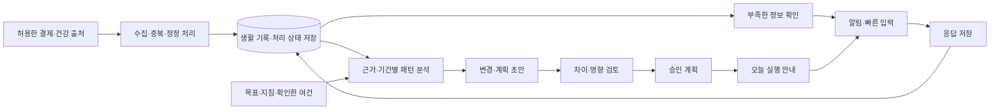
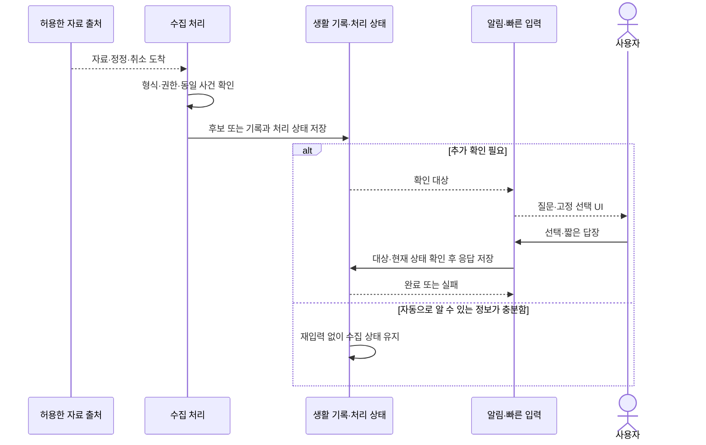

# 루틴 튜터 앱: 기능·상호작용 설계

설계 버전: D0.1 / 작성·갱신: 2026-10-17 (Asia/Seoul)
참조 명세: [v0.3](../REQUIREMENTS_SPECIFICATION.md)
상태: 설계 초안. 사용자 결정과 구현 확정을 뜻하지 않는다. 상세 아키텍처·클래스·패키지·DB·API 계약은 다음 설계 단계에서 결정한다.

## 1. 설계 목표와 진행 범위

사용자가 앱을 찾아 열어 기록하지 않아도 자동 수집과 짧은 확인으로 일상을 이해하고 바꾸도록 한다.
일상에서는 알림·빠른 확인을 주 진입점으로, 앱 화면은 상세 확인·분석·계획·설정에 사용한다.
채팅 입력만으로 모든 기능을 수행하게 하지 않고 정해진 선택 UI를 기본으로 둔다.

이번에는 다음을 설계한다.

1. 관찰·실행 중의 사용자 여정
2. 화면 구성과 알림·짧은 입력 흐름
3. 실제 기록·해석·제안·승인 계획의 상태와 관계
4. 수집→저장→필요한 확인→분석→계획 변경의 논리적 책임
5. 후속 상세 설계에서 해결할 기술 경계와 검증 항목

기존 요구를 구체화하는 안이며 새 기능 요구를 추가하지 않았다. 달리 명시하지 않은 화면·기본값·처리 정책은 제안이다.
새로 필요한 기능은 [변경 이력](../REQUIREMENTS_CHANGELOG.md)과 명세 버전에 먼저 반영한다.

## 2. 전체 구조 — 책임을 이해하기 위한 개념도



화면이 열려 있는지와 관계없이 수집된 자료와 처리 상태를 저장하는 방향이다. 위 노드는 별도 서버·마이크로서비스를 뜻하지 않는다.
현재는 개인용 앱 하나와 필요한 외부 AI 경계를 출발점으로 검토하며 서버를 여러 개로 나누지 않는다.
기기·권한 제약은 [연동 검토](../INTEGRATION_OPTIONS.md)를 따른다. 자동 수집의 완전성·즉시성·잠금화면 영구 표시를 보장하지 않는다.

## 3. 사용자 여정

| 단계 | 사용자에게 보여줄 것 | 시스템의 역할 |
|---|---|---|
| 첫 설정 | 체중 관리 방향·일상 지침과 연결 선택 | 최소 정보부터 저장, 필요한 권한을 연결 맥락에서 설명 |
| 초기 관찰 | 모인 기록과 필요한 짧은 질문 | 새 루틴을 강요하지 않고 계속 수집 |
| 분석 확인 | 실제 자료·미상 정보·해석을 구분한 요약 | 3·7·15일 단위의 지원 범위에서 분석 |
| 변경 선택 | 현재 패턴·바꿀 행동·이유·필요 시간·예상 비용 | 실행 여건에 맞는 변경 초안 제시 |
| 계획 승인 | 적용 범위·기존 계획과 차이 | 승인 성공 후 실행 기준 변경 |
| 실행·조정 | 오늘 행동·빠른 확인·바뀐 상황 | 계속 수집하고 매일 필요한 조정 제안 |

관찰과 실행은 수집 경로를 공유한다. 첫 계획 승인 후 '관찰 기능'이 꺼지는 구조로 만들지 않는다.
목표를 바꾸거나 잠시 기록이 끊겨도 기존 실제 기록을 계획에 맞게 재작성하지 않는다.

## 4. 화면과 진입점

아래는 낮은 상세도의 구성안이며 확정된 시각 디자인은 아니다.
주 메뉴 후보는 `오늘 / 기록 / 루틴 / 계획` 4개, 연결·개인정보·목표 설정은 설정 진입점으로 둔다.

### SCR-SETUP: 첫 설정

- 증량·유지·감량 방향 선택
- 일상·운동·식비 지침 선택. 세부 선택지는 Q-10 해결 후 확정
- 조리도구는 수정 가능한 기본 목록에서 없는 것을 제외
- 건강 자료·결제 알림·앱 알림은 각각 연결 목적과 현재 상태 표시
- 한꺼번에 모든 생활 정보·민감 권한을 요구하지 않는 순서를 검토
- 권한을 거부해도 지원되는 기능을 이용할 수 있게 안내. 자동화가 제한되는 범위도 표시

### SCR-NOTIFICATION: 앱 밖의 빠른 응답

| 맥락 | 질문·안내 예시 | 버튼·행동 후보 |
|---|---|---|
| 분류가 남은 결제 | 지출을 어떻게 분류할까요? | 식사 / 장보기 / 식비 아님 |
| 식사 내용이 부족함 | 식사 기록에 음식만 더할까요? | 음식 추가 / 이전과 같음 / 나중에 |
| 운동 자료가 도착함 | 운동 기록을 가져왔어요 | 보기 / 체감 추가 / 나중에 |
| 실행할 행동이 있음 | 지금 계획한 행동을 할 수 있나요? | 시작 / 미루기 / 오늘 어려움 |
| 계획 변경이 필요함 | 변경할 계획을 확인해 주세요 | 변경 보기 → 검토 후 적용 |

문구는 예시다. 하나의 알림에서 모든 행동을 동시에 보여주지 않는다.
이미 가져온 자료는 반복해서 재입력을 요구하지 않고, 사용자의 확인이 필요한 질문만 만든다.
식비가 맞다고 응답한 것을 음식 섭취나 식사 완료로 간주하지 않는다.
잠금 상태의 상세 정보와 동작은 보안 설정에 맞춰 제한하고, 필요하면 인증 후 해당 입력 화면으로 바로 이동한다.
알림이 숨겨지거나 해제되어도 미처리 항목은 기록·오늘 화면에서 다시 볼 수 있다.

### SCR-QUICK: 짧은 입력·확인

설계 원칙: 해당 사건이 미리 선택돼 있고 이미 아는 값은 채워져 있어야 한다. 사용자가 홈 화면부터 다시 찾게 하지 않는다.

```text
지출 확인                           [닫기]
가져온 금액·시각·가맹점 후보
분류       [식사] [장보기] [식비 아님]
추가 정보  필요한 항목만 표시
                          [나중에] [저장]
```

- 저장 완료·실패·대기를 명확히 표시
- 선택·입력의 양은 해당 사건에서 모르는 정보에 한정
- 필수 수치·음식 상세를 새로 늘리지 않음. 어떤 입력이 필수인지는 명세에서 합의
- 알림에서 바로 처리된 과제는 이 화면을 다시 열지 않음
- 오래된 알림·이미 처리한 사건은 중복 저장 대신 현재 처리 결과 표시
- '이전과 같음'은 사용자가 선택한 실제 이전 항목의 내용·적용 범위를 확인할 수 있는 방식으로 검토

### SCR-TODAY: 오늘

```text
오늘                               [설정]
관찰 중 / 실행 중 상태와 자료 최신성
지금 확인할 항목        처리 필요한 것부터
오늘의 행동             승인한 계획만 표시
모인 기록               자동 수집·미확인 구분
새 변경 제안            이유·영향·검토 진입점
────────────────────────────────────
오늘       기록       루틴       계획
```

관찰 중에는 '계획을 수행하지 않음'으로 평가하지 않는다. 아직 승인 계획이 없으면 모인 기록·연결 상태·짧은 확인을 우선 표시한다.
실행 중에는 승인한 행동을 중심으로 보여주며 매일의 상세 예산 잔액을 앱의 주된 행동 기준으로 삼지 않는다.

### SCR-RECORDS: 실제 기록

- 날짜·사건 순으로 식사·지출·활동을 조회하고 현재 확인 상태 표시
- 필요할 때 출처·관측 시각·수집 시각·중복 후보·정정·취소 정보를 펼쳐 확인
- 금액 미상, 분류 미상, 미동기화를 0으로 표시하지 않음
- 실제 기록 수정과 AI 해석 정정을 구분
- 한 장보기 결제를 여러 끼에 나눠 써도 실제 결제 합계에는 한 번 반영

### SCR-ROUTINE: 루틴 분석

```text
루틴                         [3일] [7일] [15일]
이번 분석의 날짜 범위·기록 범위·기준 시점
확인된 패턴                  근거 보기
추가 확인할 부분              짧게 정정
시도할 변경 후보              이유·시간·비용
```

3·7·15일은 분석 단위다. 정확한 날짜 경계·누적/이동 기간·최소 충족 조건은 D-OPEN-01에서 정한다.
기록이 부족하면 분석 가능한 범위를 보여주며 존재하지 않는 경향을 생성하지 않는다.
신체 변화 대신 식비·실행·부담 등 실제로 확보한 정보의 변화를 우선 제시한다.

### SCR-PLAN: 계획과 변경 검토

- 승인 계획과 새 초안의 구분
- 월·주 기간 선택과 승인 범위는 Q-01 상세 합의에 맞춰 구성
- 새 초안에는 '무엇을 왜 바꾸는지', 시간·예상 지출·장보기에 미치는 영향 표시
- 거절·무응답·저장 실패 중에는 기존 승인 계획 유지
- 큰 목록을 다시 읽게 하기보다 변경된 항목을 우선 표시하고 전체 계획도 확인 가능하게 구성
- 현재는 자동 적용 권한을 부여하지 않는 설계 초안. 작은 변경을 위임할 범위를 합의하면 명세와 설계를 함께 갱신

### SCR-SETTINGS: 설정과 연결

- 현재 목표·일상 지침·조리 환경·확인한 가용 시간
- 출처별 권한·연결·마지막 수집·실패 상태
- 알림 빈도·조용한 시간·묶음 확인·잠금화면 노출 선택
- 외부 AI 전송 항목·보관·삭제 범위는 Q-07 합의 후 구체화
- 실제 건강·금융 자료를 공개 저장소나 진단 로그에 남기지 않는 방향

## 5. FLOW-CAPTURE: 자동 수집에서 확인까지



설계할 때 지킬 조건:

1. 알림을 게시하기 전에 대상 기록·질문을 식별할 수 있어야 한다.
2. 같은 외부 사건 재수집·버튼 연타·재시도로 실제 기록이 늘어나지 않아야 한다.
3. 삼성페이와 카드사 앱의 동일 거래는 후보 관계를 관리한다. 애매하면 자동으로 합쳐 확정하지 않는다.
4. 가져온 결제·운동의 수정·삭제·취소를 처리할 수 있도록 출처 정보를 유지한다.
5. 알림을 해제하거나 대답하지 않은 것을 '안 먹음·안 움직임·변경 승인'으로 해석하지 않는다.
6. 앱이 재시작되면 저장된 처리 상태를 기준으로 진행한다. 백그라운드 수신이 열린 Flutter 화면의 ViewModel에만 의존하지 않게 한다.

세부 저장 트랜잭션·백그라운드 실행 위치·재시도 조건·출처 식별 키는 후속 아키텍처 설계 대상이다.

## 6. FLOW-PLAN: 분석에서 승인 계획까지

1. 분석 대상 기간, 사용한 기록·목표·지침의 기준을 정한다.
2. 확인된 수치·자료 범위를 계산하고 AI에 필요한 범위만 전달하는 방향을 검토한다.
3. AI는 생활패턴 설명과 변경·계획 초안을 제안한다.
4. 초안의 데이터 형식과 사용자 제약을 검증하고 근거·미상·추정값을 구분한다.
5. 사용자가 차이와 영향을 검토하고 승인한다.
6. 검토한 기준이 유효하고 저장이 성공했을 때 승인 계획을 전환한다.

실제 기록·금액 합산·중복 처리·승인 상태 전환은 앱의 명확한 규칙으로 관리한다. AI가 대화 문장으로 이 상태를 직접 확정하지 않게 한다.
검토 중 새 자료나 기존 계획 변경이 도착했을 때는 영향 여부를 확인한다. 오래된 초안을 무조건 적용하지 않는다. 재검토 조건은 상세 설계에서 정한다.
매일 조정은 필요한 변경을 제안하는 기능이며 사용자 응답이 없다는 이유로 목표·예산·완료 기록을 바꾸지 않는다.

## 7. DATA-01: 구분해서 보존할 정보

아래는 개념 관계이며 최종 DB 스키마·클래스 설계가 아니다.

| 정보 | 책임과 관계 |
|---|---|
| 목표·지침 | 증량·유지·감량과 운동·식비 방향. 어떤 기준으로 분석했는지 연결 |
| 수집 출처·상태 | 권한·마지막 수집·지연·실패. 수집 안 됨을 활동 없음과 구분 |
| 관찰·실제 기록 | 실제 식사·활동·지출과 확인 상태. 계획과 독립적으로 유지 |
| 중복·정정 관계 | 하나의 사건에 대한 여러 자료·취소·사용자 보완의 관계 |
| 질문·응답 | 어떤 자료의 무엇을 물었고 처리했는지. 알림 표시 상태와 별도 |
| 분석 결과 | 대상 기간·입력 기준·근거·해석·불확실성. 실제 기록과 구별 |
| 변경·계획 초안 | 제안한 행동과 예상 영향, 기반 분석·계획과 연결 |
| 승인 계획 | 사용자가 채택한 실행 기준과 버전. 새 버전 승인 전까지 유지 |

수집 자료 전체를 무기한 원문 보관한다는 뜻은 아니다. 보관·삭제·암호화·외부 전송 범위를 아키텍처 단계에서 구체화한다.
AI가 이용 불가한 상태에서도 이미 저장한 실제 기록·질문 처리 결과·승인 계획을 구분해 관리하는 방향이다. 오프라인 기능 범위는 Q-07에서 합의한다.

## 8. 후속 아키텍처 설계의 출발 후보

Flutter 공식 가이드의 View·ViewModel·Repository·Service 책임 분리를 참고한다. 복잡하고 여러 진입점에서 재사용되는 승인·수집 규칙만 필요한 경우 별도 로직으로 분리한다.
이는 특정 라이브러리나 모든 클래스의 추상화를 미리 확정하는 것이 아니다.
근거: [Flutter 앱 아키텍처](https://docs.flutter.dev/app-architecture/guide).

| 논리적 영역 | 역할 | 아직 정하지 않은 것 |
|---|---|---|
| Flutter 화면·상태 | 오늘·기록·루틴·계획·설정·빠른 입력 | 상태 관리 패키지·라우팅·화면별 클래스 |
| Android 연동 | 결제 알림·Health Connect·알림 동작과 OS 제약 처리 | 플러그인·플랫폼 채널의 책임·백그라운드 실행 방식 |
| 데이터·업무 규칙 | 중복·정정·집계·질문 처리·계획 전환 | 로컬 DB·트랜잭션·저장 모델 |
| 분석·계획 제안 | 근거 있는 요약·AI 초안·제약 검사 | AI 제공자·서버·전송 계약 |

네이티브 Android 콜백과 Flutter 간 데이터 전달, AI 비밀키의 서버 경계, 기기 내 저장의 보안은 다음 설계의 핵심이다.
Health Connect는 새 자료·수정·삭제의 동기화를 다뤄야 하므로, 한 번 읽고 끝내는 인터페이스로 가정하지 않는다.
근거: [Health Connect 동기화](https://developer.android.com/health-and-fitness/health-connect/sync-data).

## 9. QUALITY-01: 설계를 검증할 대표 시나리오

아직 실행한 테스트가 아니며 향후 테스트 설계에 연결할 항목이다.

| 시나리오 | 기대 동작 | 관련 요구 |
|---|---|---|
| 같은 결제가 여러 번 도착 | 중복 집계 방지, 모호하면 후보 상태 | REQ-INGEST-004, REQ-BUDGET-001 |
| 늦게 도착한 운동 기록 | 원래 활동 시각에 연결, 수집 전은 미상 | REQ-INGEST-002/003 |
| 알림 응답 직후 재실행 | 성공 저장한 응답 복구, 같은 질문 중복 처리 방지 | REQ-INTERACT-002, NFR-DATA-001 |
| 알림·건강 권한 거부 또는 회수 | 지원 범위를 표시하고 누락을 0으로 해석하지 않음 | REQ-INGEST-003 |
| 잠금 상태의 빠른 확인 | 허용한 내용만 노출, 인증 필요 시 해당 항목으로 이동 | NFR-LOCK-001 |
| 불충분한 3일 자료 | 기록 범위·불확실성 표시, 확정 패턴으로 표현하지 않음 | REQ-ROUTINE-002/004 |
| AI·네트워크 실패 | 실제 기록·승인 계획 보존, 실패와 처리 대기 구분 | REQ-PLAN-001/002, NFR-DATA-001 |
| 오래된 변경 알림에 응답 | 현재 상태 확인 후 처리, 잘못된 버전으로 전환하지 않음 | REQ-PLAN-001/002/004 |

성능·배터리·조작 수·소요시간 수치는 실기·대표 과제 측정 후 합의한다. 임의의 '완전 자동·항상 즉시'를 품질 기준으로 쓰지 않는다.

## 10. 설계에서 남긴 결정

| ID | 결정할 내용 | 현재 제안 |
|---|---|---|
| D-OPEN-01 | 분석 창 계산 | 3·7·15일 선택을 제공하되 누적/이동·달력일/기록일·최소 자료 조건은 미정 |
| D-OPEN-02 | 자동 처리·사용자 확인 경계 | 출처 자료는 재입력 최소화, 음식 섭취·불명확 분류는 짧게 확인. 자동 식비 집계 규칙 미정 |
| D-OPEN-03 | 계획 변경 위임 범위 | 현재는 변경 초안·빠른 승인. 사전 위임할 작은 변경 범위는 미정 |
| D-OPEN-04 | 알림 기본 정책 | 조용한 시간·묶음·미루기·노출 제어 제공 방향, 기본값 미정 |
| D-OPEN-05 | 기기 연동·백그라운드 계약 | 사용자 제공 기기에서 작은 시험으로 지원 범위 확인 후 확정 |
| D-OPEN-06 | 저장·외부 전송·삭제 | 로컬 중심 출발 후보, 보호·전송·삭제 계약은 미정 |

이 항목이 남아 있어도 현재 이해한 범위의 설계를 진행할 수 있다. 구현 시 필요한 항목은 해당 흐름을 만들기 전에 해결한다.

## 11. 이후 진행 순서

1. 현재 화면·주요 상호작용을 검토하고 필요한 상세 시안을 만든다.
2. Android 연동의 작은 시험 범위·성공 기준과 앱 데이터 전달 경계를 설계한다.
3. 아키텍처·저장 모델·클래스 책임·인터페이스를 구체화한다.
4. 실제 문제에 맞는 패턴을 선택하고 구현·테스트한다.

현재 D0.1은 문서와 개념 다이어그램 작성 단계다. Flutter 프로젝트 생성, 실기 연동, 화면 구현, 앱 빌드·테스트는 하지 않았다.
