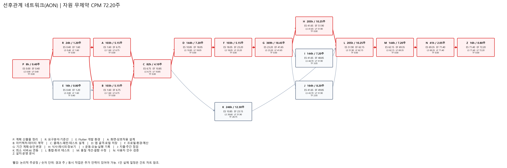
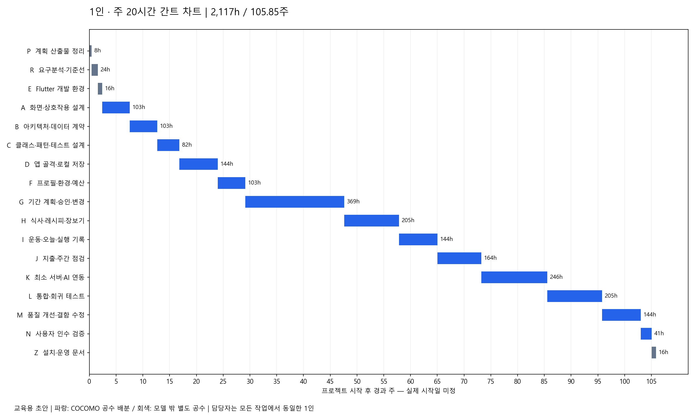

# 계산 결과 — 자동 생성

`python tools/estimate_plan.py`로 재생성한다. 입력 가정과 해석은 [계획 문서](PLAN.md)를 먼저 읽는다.

## 규모별 민감도

| KSLOC | PM | 시간 | 본체 1인·주20h 기간 | COCOMO TDEV(월) | 예시 인건비(원) |
|---:|---:|---:|---:|---:|---:|
| 3 | 9.841 | 1,495.83 | 74.79주 | 7.59 | 44,874,789 |
| 4 | 13.503 | 2,052.47 | 102.62주 | 8.40 | 61,574,025 |
| 6 | 21.090 | 3,205.71 | 160.29주 | 9.67 | 96,171,215 |

## 작업·CPM·1인 일정

시작은 0, 종료는 다음 작업 시작이 가능한 경과 주다. 표의 기간은 반올림 전 값으로 계산한다.

| ID | 작업 | h | 선행 | ES | EF | LS | LF | TF | 1인 시작 | 1인 종료 |
|---|---|---:|---|---:|---:|---:|---:|---:|---:|---:|
| P | 계획 산출물 정리 | 8 | — | 0.00 | 0.40 | 0.00 | 0.40 | 0.00 | 0.00 | 0.40 |
| R | 요구분석·기준선 | 24 | P | 0.40 | 1.60 | 0.40 | 1.60 | 0.00 | 0.40 | 1.60 |
| E | Flutter 개발 환경 | 16 | P | 0.40 | 1.20 | 0.80 | 1.60 | 0.40 | 1.60 | 2.40 |
| A | 화면·상호작용 설계 | 103 | R | 1.60 | 6.75 | 1.60 | 6.75 | 0.00 | 2.40 | 7.55 |
| B | 아키텍처·데이터 계약 | 103 | R,E | 1.60 | 6.75 | 1.60 | 6.75 | 0.00 | 7.55 | 12.70 |
| C | 클래스·패턴·테스트 설계 | 82 | A,B | 6.75 | 10.85 | 6.75 | 10.85 | 0.00 | 12.70 | 16.80 |
| D | 앱 골격·로컬 저장 | 144 | C | 10.85 | 18.05 | 10.85 | 18.05 | 0.00 | 16.80 | 24.00 |
| F | 프로필·환경·예산 | 103 | D | 18.05 | 23.20 | 18.05 | 23.20 | 0.00 | 24.00 | 29.15 |
| G | 기간 계획·승인·변경 | 369 | F | 23.20 | 41.65 | 23.20 | 41.65 | 0.00 | 29.15 | 47.60 |
| H | 식사·레시피·장보기 | 205 | G | 41.65 | 51.90 | 41.65 | 51.90 | 0.00 | 47.60 | 57.85 |
| I | 운동·오늘·실행 기록 | 144 | G | 41.65 | 48.85 | 44.70 | 51.90 | 3.05 | 57.85 | 65.05 |
| J | 지출·주간 점검 | 164 | G | 41.65 | 49.85 | 43.70 | 51.90 | 2.05 | 65.05 | 73.25 |
| K | 최소 서버·AI 연동 | 246 | C | 10.85 | 23.15 | 39.60 | 51.90 | 28.75 | 73.25 | 85.55 |
| L | 통합·회귀 테스트 | 205 | H,I,J,K | 51.90 | 62.15 | 51.90 | 62.15 | 0.00 | 85.55 | 95.80 |
| M | 품질 개선·결함 수정 | 144 | L | 62.15 | 69.35 | 62.15 | 69.35 | 0.00 | 95.80 | 103.00 |
| N | 사용자 인수 검증 | 41 | M | 69.35 | 71.40 | 69.35 | 71.40 | 0.00 | 103.00 | 105.05 |
| Z | 설치·운영 문서 | 16 | N | 71.40 | 72.20 | 71.40 | 72.20 | 0.00 | 105.05 | 105.85 |

- 논리적 주공정 1: P → R → A → C → D → F → G → H → L → M → N → Z
- 논리적 주공정 2: P → R → B → C → D → F → G → H → L → M → N → Z
- 자원 무제약 CPM: 72.20주
- 1인 자원 제약 일정: 105.85주 (106번째 주 중 종료)
- 전체 공수: 2,117h = COCOMO 본체 올림 2,053h + 모델 밖 64h
- 예시 전체 인건비: 63,510,000원 (미확정 단가)

## 마일스톤

| 완료 지점 | 의미 | 경과 주 |
|---|---|---:|
| R | 요구 기준선 | 1.60 |
| C | 구조·클래스 설계 | 16.80 |
| G | 예시 데이터 계획 승인 흐름 | 47.60 |
| K | 기능별 구현·AI 연결 | 85.55 |
| N | 인수 검증 | 105.05 |
| Z | 개인용 설치·운영 안내 | 105.85 |

## 차트

